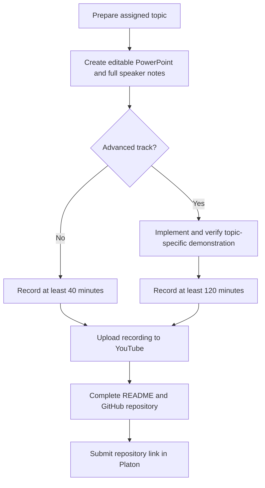
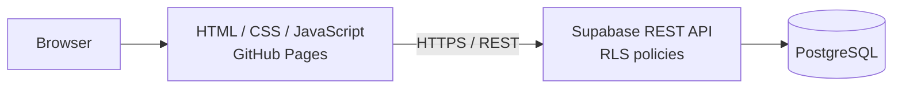
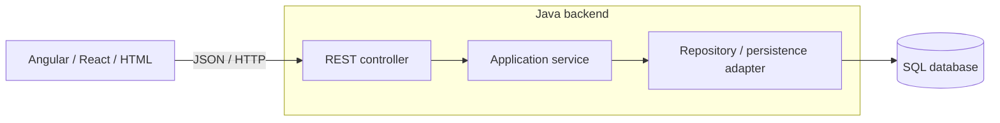
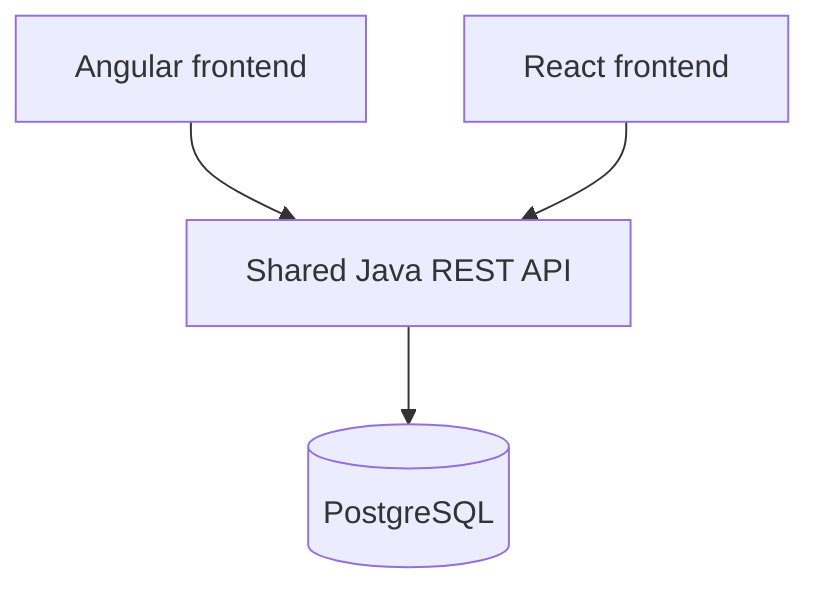
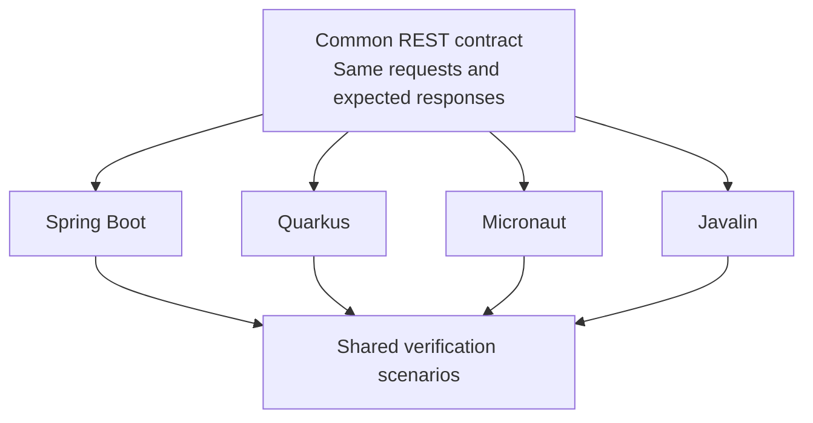
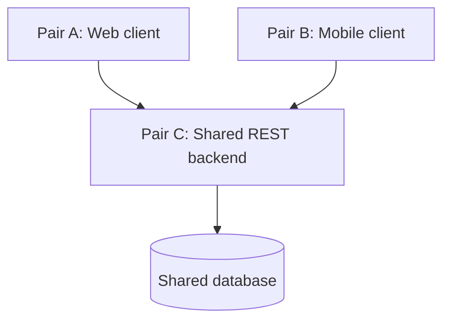
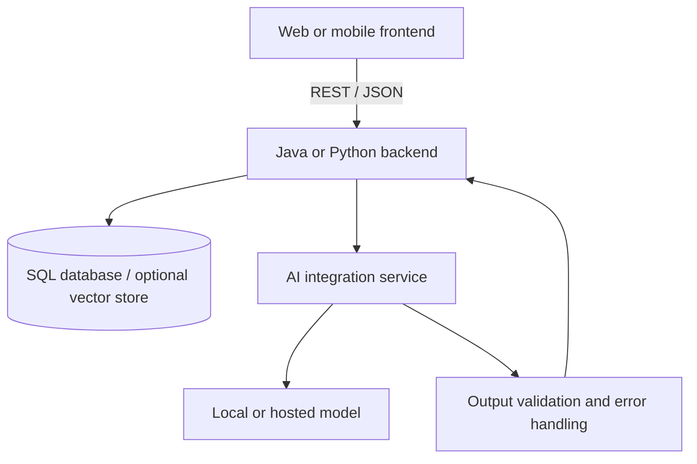
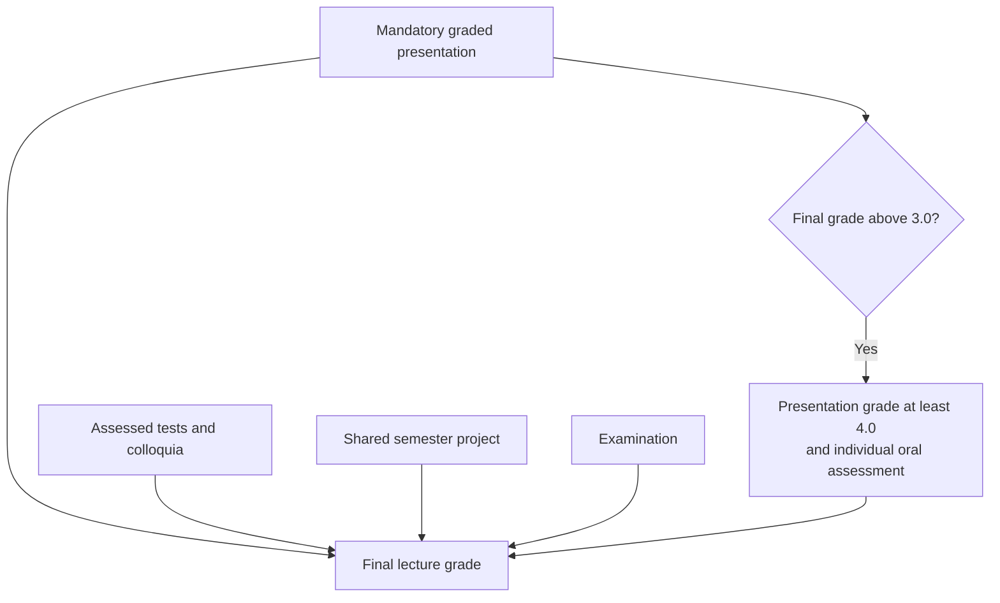

# Technical Presentation – Repository and Documentation Guide

**Course: Team Project – IT**

Each team prepares one presentation in its own GitHub repository. The examples below show how to organise the submission so that the lecturer can inspect the materials, reproduce the demonstration and assess the work. The exact technical requirements depend on your assigned topic.

## 1. Required repository structure

### Basic track (40 minutes)

```text
presentation-topic-name/
├── README.md              # Required: links, authors, outline and references
├── presentation.pptx      # Required: editable slides with full speaker notes
├── presentation.pdf       # Optional: convenient viewing copy
└── doc/                   # Optional: additional diagrams and supporting material
```

A theoretical presentation is sufficient for the basic track. No runnable application is required. If you demonstrate any runnable project, include its source and instructions.

### Advanced track (120 minutes)

```text
presentation-topic-name/
├── README.md
├── presentation.pptx
├── presentation.pdf       # Optional
├── doc/
│   ├── architecture.png   # Example: architecture diagram
│   ├── application-running.png
│   ├── api-requests.png
│   └── database-schema.png # Where applicable
└── examples/
    ├── backend/
    │   ├── README.md       # Build, run, test and configuration
    │   └── ...             # Complete source and build files
    ├── frontend/           # Where applicable
    │   └── ...
    └── database/           # Where applicable: migrations, schema, demo data
        └── ...
```

README.md, editable PowerPoint with notes, source code for every demonstrated application, reproducible instructions and actual screenshots are mandatory for advanced work. PDF is optional. The directory names under examples/ and screenshot filenames are illustrative; adapt them to your framework. Do not reorganise a standard framework project unnecessarily. No empty frontend or database folder is required for an API-only comparison.

### Example: four-framework comparison (A04)

```text
presentation-java-frameworks-comparison/
├── README.md
├── presentation.pptx
├── presentation.pdf       # Optional
├── doc/
│   ├── architecture.png
│   └── screenshots/       # Evidence for all four APIs
├── examples/
│   ├── spring-boot/
│   ├── quarkus/
│   ├── micronaut/
│   └── javalin/
└── tests/                 # Shared verification suite recommended; required for the 5.0 comparison criterion
```

All four projects must run independently. In-memory storage is sufficient for this topic; four frontends, databases or hosted deployments are not required.

## 2. README.md template

Copy and adapt this template. Replace placeholders with real information; do not commit secrets or real personal data. Include the student identifiers only as required for assessment and use approved access arrangements if needed.

```markdown
# Presentation title

## Authors and contributions
- Student A: contribution and relevant Git history
- Student B: contribution and relevant Git history

## Links
- GitHub repository: https://github.com/USERNAME/REPOSITORY
- YouTube recording: https://www.youtube.com/watch?v=VIDEO_ID
- PowerPoint: [presentation.pptx](presentation.pptx)
- PDF (optional): [presentation.pdf](presentation.pdf)
- Hosted demo (if applicable): URL

## Learning objectives
What should a viewer understand after watching the presentation?

## Contents and timestamps
- 00:00 Introduction
- ... Theory, architecture, demonstrations, conclusions

## Application overview (if applicable)
Purpose, architecture, components, design decisions and limitations.

## Prerequisites and setup (if applicable)
JDK or Python runtime, framework/build tool versions, database configuration, example data. For AI demos: model/runtime, model configuration, required environment variables and evaluation setup.
Exact commands to build, run and test each demonstrated project.
Expected URLs, ports and output.

## API and database (if applicable)
Example requests/responses, error cases, schema, relationships and queries.

## Verification and deployment (if applicable)
Test commands, actual results, screenshots, deployment instructions and links.

## References
Official documentation and other sources.
```

## 3. Submission workflow



The recording may use human or AI narration. The notes must match the recording. AI-generated code is allowed but must actually run and be understandable by the team.

## 4. Example architecture diagrams

These are illustrative designs, not additional mandatory technologies. Use a diagram that matches the application you actually demonstrate.

### Basic web architecture: GitHub Pages and Supabase



### Advanced Java web application



### Two different clients sharing an API



### Framework comparison (A04)



### Several cooperating project teams (optional challenge)



### AI-powered application (optional track)



Document the model, configuration, input/output contract, data sources, limitations and evaluation. Keep secrets server-side. Include real demonstration evidence, representative success and failure cases, and reproducible tests. No paid provider is compulsory.

## 5. Final lecture grade



The presentation grade is not the final lecture grade. The shared semester project also contributes to both Laboratory and Lecture; there is no separate final project grade. A minimum 120-minute presentation and assignment grade of at least 4.0 are necessary for a final lecture grade above 3.0, but do not guarantee it.

## 6. Submission checklist

### All presentations

- [ ] Correct assigned topic and identifiable individual contributions
- [ ] Separate GitHub repository accessible to the lecturer
- [ ] README.md with real recording and material links
- [ ] Editable PPTX with complete speaker notes
- [ ] YouTube recording accessible to the lecturer (unlisted is fine)
- [ ] Minimum duration met: 40 or 120 minutes
- [ ] References and licences checked
- [ ] Repository link submitted in Platon

### Advanced presentations

- [ ] All demonstrated source projects included and runnable
- [ ] Exact build, run and test instructions
- [ ] Actual screenshots of running application/API
- [ ] Architecture and design decisions explained
- [ ] API requests, validation and error cases documented
- [ ] Database setup and sample data where applicable
- [ ] Tests and deployment evidence as required by the assigned topic
- [ ] No credentials, private keys or real personal data committed
- [ ] For AI demonstrations: real model execution, model/runtime setup, output validation, error cases and evaluation evidence documented

See [Presentation Topics](presentation-topics.md) and [Assessment and Passing Requirements](student-assessment-requirements.md) for the complete assessment rules.
