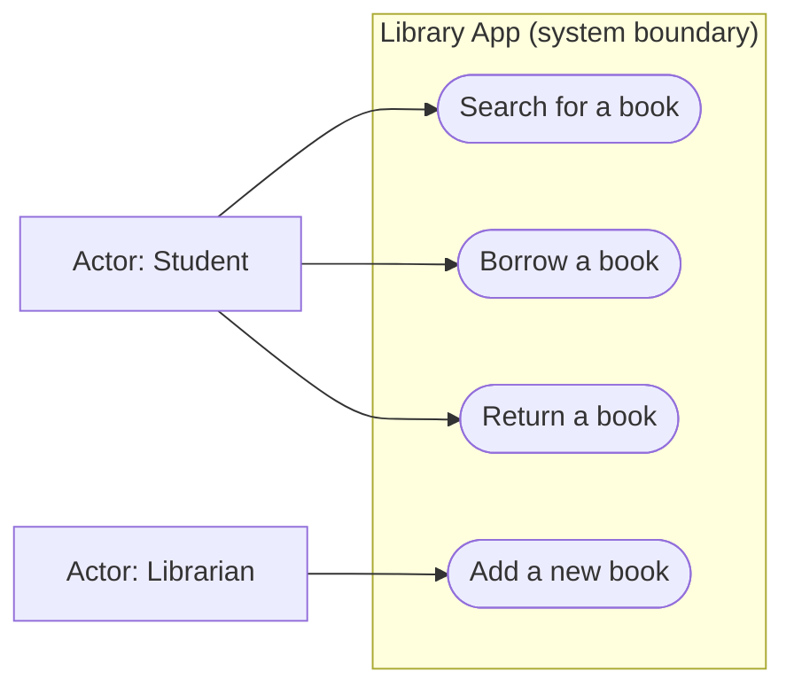

# Module 2 — Agile, Scrum and Basic Requirements

*Vistula University · IT Fundamentals*

## Learning Objectives

After this module, you can:

- Explain what Agile means and how it differs from one big delivery at the end.
- Name the four values of the Agile Manifesto.
- List the twelve Agile principles with a simple example for each.
- Describe Scrum, its roles, its events, and its two main backlogs.
- Write a user story in the correct format, with acceptance criteria.
- Tell the difference between functional and non-functional requirements.
- Read and draw a simple UML use case diagram with actors and use cases.

---

## 1. What is Agile?

When people build software, they must decide *how* to work. There are two main styles.

**The old way (sometimes called "waterfall"):** you plan everything first, in one very long document. Then you build the whole product for many months and show it to the customer only at the very end. The problem: if the customer does not like it, you have lost a year of work.

**The Agile way:** you build the product in **small pieces**, again and again. Every few weeks, you finish a small part that really works, show it to the customer, and get feedback. "Iterative" means you repeat this cycle many times. "Incremental" means each cycle adds one more piece.

**A simple analogy:** cooking dinner for a friend. The old way: cook everything alone for three hours and bring it to the table — maybe your friend hates fish. The Agile way: bring a small soup first and ask "Do you like it?", then the main dish, and ask again. You learn after every step, so the final dinner fits your friend better.

So, **Agile = build a small working piece → show it → get feedback → repeat.**

### The Agile Manifesto values

In 2001, a group of software developers wrote a short document called the **Agile Manifesto**. It contains four values. It does not say the things on the right are bad — only that the things on the left are *more* important.

1. **Individuals and interactions** over processes and tools. — Good people talking beat perfect paperwork.
2. **Working software** over comprehensive documentation. — A program that really runs is worth more than a thick book of plans.
3. **Customer collaboration** over contract negotiation. — Talk with the customer all the time, not hide behind a contract.
4. **Responding to change** over following a plan. — When something changes, change the plan.

### The twelve Agile principles

The Manifesto also has twelve principles. Here are all twelve, grouped so they are easier to remember.

**Group A — about delivering value:**

1. **Customer satisfaction.** Give value to the customer early and often.
2. **Welcome changing requirements.** Even late changes make the product better.
3. **Deliver working software frequently.** For example, every two weeks, deliver something the customer can try.
4. **Business people and developers work together daily.**

**Group B — about people and quality:**

5. **Build projects around motivated people.** Give them trust and support.
6. **Face-to-face conversation.** A direct talk shares information best.
7. **Working software is the main measure of progress.** Progress is not "50 pages written"; it is "this part works".
8. **Sustainable pace.** The team works at a steady speed, not 16 hours a day before a deadline.

**Group C — about doing things well:**

9. **Continuous attention to technical excellence.** Write clean code, so the product stays easy to change.
10. **Simplicity.** Do the simplest thing that works; do not build extra things "just in case".
11. **Self-organizing teams.** The team decides itself how to do the work.
12. **Regular reflection.** Every few weeks the team asks: "How can we work better?" — and changes something.

---

## 2. Scrum

**Scrum** is the most popular Agile framework — a simple set of roles, events and lists. Its purpose: organize work into short repeating cycles, so the team always delivers something useful and learns from feedback.

### Sprints

A **Sprint** is one repeating cycle of work. It is usually 1–4 weeks long (often two weeks). At the end of every Sprint, the team shows a working part of the product. Then a new Sprint starts immediately.

### The two backlogs

A "backlog" is a simple list of work to do.

- The **Product Backlog** is the *big list* of everything that the product may need — all features, ideas and fixes. It is ordered: the most important items are at the top. It lives for the whole life of the product.
- The **Sprint Backlog** is the *small list* for one Sprint only. At the start of a Sprint, the team picks the most important items from the Product Backlog and puts them into the Sprint Backlog.

Think of shopping: the Product Backlog is your list for the whole week; the Sprint Backlog is what you put in your basket on one trip.

### The five Scrum events

- **Sprint Planning.** A meeting at the start of the Sprint. The team decides *what* will be done in this Sprint and *how*.
- **Daily Scrum.** A short meeting every day, maximum 15 minutes. Each person answers: What did I do yesterday? What will I do today? What blocks me?
- **Sprint Review.** A meeting at the end of the Sprint. The team *shows the working product part* to the customer and gets feedback.
- **Sprint Retrospective.** A meeting after the Review, only for the team. They ask: "What was good? What can we improve in *the way we work*?" It is about the process, not the product.
- (The Sprint itself also counts as an event — it holds all the others.)

### The three Scrum roles

- **Product Owner (PO).** One person who decides *what* the team builds. The PO owns the Product Backlog, orders it by importance, and talks to the customer — the "voice of the customer".
- **Scrum Master (SM).** The person who protects the *process*. The SM organizes the meetings, removes obstacles (problems that block the team), and teaches everyone Scrum. The Scrum Master is *not* a boss who gives orders.
- **Developers.** The people who build the product: programmers, testers, designers. They are a self-organizing team.

---

## 3. Requirements and user stories

A **requirement** is a clear description of what the product must do or must have.

### User stories

A **user story** is a very short requirement, written from the point of view of one user. The format is:

> **As a** *(kind of user)*, **I want** *(some goal)*, **so that** *(the benefit)*.

Example: *"As a student, I want to save my notes, so that I do not lose them after closing the app."*

Each part matters: "as a" says who needs it, "I want" says what, "so that" says why.

### Acceptance criteria

**Acceptance criteria** are the conditions that must be true for the user story to count as "done". They are like a small checklist. Example for the story above:

- The user can save a note with one click.
- The note is still there after closing and reopening the app.
- The user sees a message "Saved!" after saving.

### Functional vs non-functional requirements

- A **functional requirement** says what the system *does* — a feature or action. Examples: "The user can log in with an email and password." / "The app can show a list of all my orders."
- A **non-functional requirement** says *how well* the system works — quality, not a feature. Examples: "The page must load in under 2 seconds." / "All passwords must be stored in encrypted form."

Easy test: if you check it by *using* a feature, it is functional; if it describes quality (speed, safety), it is non-functional.

---

## 4. UML use case diagrams

**UML** (Unified Modeling Language) is a set of standard diagrams for describing software. A **use case diagram** shows *who* will use the system and *what* they can do with it.

Four things:

- **Actor** — a person or system *outside* the system that uses it. Drawn as a simple stick person. Example: *Student*, *Teacher*, also *Payment system* (an external system can be an actor).
- **Use case** — one thing the actor wants to do with the system. Drawn as an **oval** (an ellipse) with a short name like "Log in".
- **System boundary** — a big rectangle around all the ovals. Everything inside is the system; everything outside is an actor.
- **Association lines** — simple lines connecting an actor to the use cases they can do.

### A tiny example: a university library app

Actors: **Student** and **Librarian**. Use cases inside the system boundary: *Search for a book*, *Borrow a book*, *Return a book*, *Add a new book*. The Student can search, borrow and return. The Librarian can add a new book.

Below is a **simplified diagram** (Mermaid cannot draw true UML ovals and stick people, so this flowchart-style version shows actors and use cases — actor nodes = stick persons, oval nodes = use cases):

How to read it: the rectangle is the system boundary; the nodes inside are use cases; the actor nodes outside connect by lines to the use cases they can perform. In one small picture, the customer sees what the system will and will not do.

---

## Key Terms (Glossary)

| Term | Simple meaning (English) | Po polsku |
|---|---|---|
| Agile | Building software in small pieces with frequent feedback. | Zwinny (podejście zwinne) |
| Scrum | The most popular Agile framework — roles, events and lists. | Scrum |
| Sprint | A short repeating cycle of work, usually 1–4 weeks. | Sprint |
| Product Backlog | The big, ordered list of everything the product may need. | Product Backlog (lista produktu) |
| Sprint Backlog | The list of tasks chosen for one Sprint. | Sprint Backlog (lista na Sprint) |
| Product Owner | The person who decides what the team builds. | Właściciel produktu |
| Scrum Master | The person who protects the process and removes obstacles. | Scrum Master |
| User story | A short requirement in the format "As a … I want … so that …". | Historyjka użytkownika |
| Acceptance criteria | The checklist conditions for a story to be "done". | Kryteria akceptacji |
| Actor | A person or system outside the system that uses it. | Aktor |
| Use case | One thing an actor can do with the system (an oval). | Przypadek użycia |
| Functional requirement | What the system must do — a feature. | Wymaganie funkcjonalne |
| Non-functional requirement | How well the system works — speed, safety. | Wymaganie niefunkcjonalne |

---

## Summary

- Agile means delivering the product in small working pieces, with feedback after each piece.
- The Agile Manifesto has four values and twelve principles.
- Scrum organizes work in Sprints: short cycles that end with a working part of the product.
- The Product Backlog is the big list for the whole product; the Sprint Backlog is the small list for one Sprint.
- The three Scrum roles are Product Owner, Scrum Master and Developers.
- A user story follows "As a … I want … so that …" and needs acceptance criteria — a "done" checklist.
- A use case diagram shows actors outside a system boundary, connected by lines to ovals that are the use cases.
